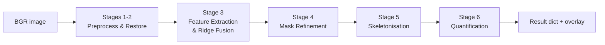

# CrackVision

**A classical computer-vision pipeline for detecting, skeletonising and measuring surface cracks — no deep learning, no training data.**


CrackVision takes a photograph of a concrete / masonry surface and runs it through a six-stage
signal-processing pipeline: illumination correction in the frequency domain, multi-scale ridge
fusion (Sato + Gabor + black-hat), morphological linking, component filtering and Zhang-Suen
skeletonisation. It then reports crack **length, width, orientation, area density and a severity bin**.

---

## Pipeline



| Stage | What happens | Module |
|------:|--------------|--------|
| 1–2 | Median + bilateral denoising, **homomorphic filtering** (shadow / illumination correction), optional CLAHE, Butterworth low-pass background subtraction, high-boost sharpening | `preprocessing.py` |
| 3 | Sobel / Canny / Laplacian edge evidence, Otsu thresholding, **multi-scale ridge fusion** (Sato + 8-orientation Gabor + black-hat) with hysteresis | `features.py` |
| 4 | Directional line closing (0°/45°/90°/135°), connected components, skeleton-length filter, **elongation filter** rejecting round stains and pores | `refinement.py` |
| 5 | Zhang-Suen skeleton | `refinement.py` |
| 6 | Distance-transform width along the skeleton, length, PCA orientation, severity bin (hairline / moderate / severe), crack-pixel density, binary crack decision | `measurement.py` |

`detect_cracks()` in `detector.py` chains all stages and also builds a green-mask / red-skeleton overlay.

## Benchmark

Evaluated on the Kaggle [Surface Crack Detection](https://www.kaggle.com/datasets/arunrk7/surface-crack-detection)
dataset using a random, class-balanced sample of 1,000 positive + 1,000 negative images
(seed 42, default `Config`). Figures below are taken from the saved output of the original notebook run.

| Metric | Value |
|--------|------:|
| Overall accuracy | 82.15 % |
| Precision | 73.69 % |
| Recall / sensitivity | 100.00 % |
| F1-score | 84.85 % |
| Positive-class score (TP / 1000) | 100.00 % |
| Negative-class score (TN / 1000) | 64.30 % |

The default configuration is recall-oriented: no cracked image was missed in this sample, at the cost
of false alarms on textured negatives (357 / 1000). Thresholds such as `detect_len`, `min_elong` and
`hyst_hi` in `Config` are the levers for trading recall against specificity.

## Project structure

```
crackvision/
├── crackvision/            # Importable package
│   ├── config.py           #   Config dataclass + shared CFG, RNG seeding
│   ├── image_ops.py        #   I/O, uint8 normalisation, FFT kernels & filters
│   ├── preprocessing.py    #   Stages 1-2
│   ├── features.py         #   Stage 3
│   ├── refinement.py       #   Stages 4-5
│   ├── measurement.py      #   Stage 6
│   ├── detector.py         #   detect_cracks(): full pipeline
│   ├── visualization.py    #   13-panel figure + console summary
│   └── evaluation.py       #   Pixel-level & folder-level metrics
├── scripts/run_benchmark.py  # Kaggle download -> batch run -> report
├── tests/                  # Fidelity + parity + sanity tests
├── notebooks/original/     # Untouched source notebook + SHA-256
├── docs/NOTEBOOK_MAPPING.md
└── .github/workflows/ci.yml
```

## Installation

```bash
git clone https://github.com/<your-username>/crackvision.git
cd crackvision
python -m venv .venv && source .venv/bin/activate   # Windows: .venv\Scripts\activate
pip install -e .
```

## Usage

**Analyse a single image**

```python
from crackvision import load_image, detect_cracks, display_results, print_console_summary

bgr = load_image("wall.jpg")
results = detect_cracks(bgr)

print_console_summary("wall.jpg", results)
display_results(bgr, results)

print(results["is_cracked"], results["length_px"], results["max_width_px"], results["severity"])
```

**Tune the pipeline**

```python
from crackvision import CFG
CFG.detect_len = 40          # require longer skeletons before flagging a crack
CFG.mm_per_px = 0.2          # physical scale (set is_calibrated = True to report mm)
CFG.is_calibrated = True
```

**Reproduce the dataset benchmark**

```bash
python scripts/run_benchmark.py
```

This downloads the dataset through `kagglehub` (a Kaggle account / API token may be required), classifies
the sampled images and prints the evaluation report.

**Run the tests**

```bash
pip install -e ".[dev]"
pytest
```

